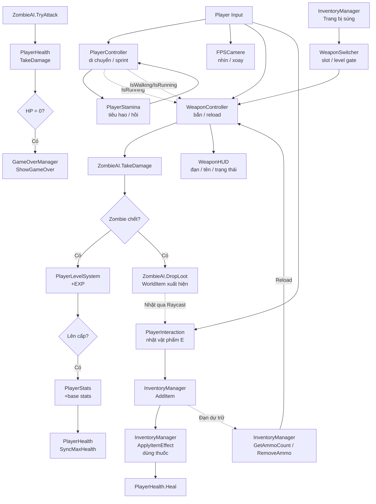

# Tài liệu hệ thống Player — Survival Game 3D

> Tài liệu này tổng hợp chức năng, luồng và logic Player hiện có, bao gồm trang bị/đổi vũ khí,
> quản lý đạn dự trữ và HUD vũ khí.

---

## 1. Kiến trúc tổng thể của Player

```
Player (GameObject gốc)
├── CharacterController          ← PlayerController điều khiển
├── PlayerController.cs          ← Di chuyển, sprint, bước chân
├── PlayerHealth.cs              ← HP, nhận damage, chết
├── PlayerStats.cs               ← Coin, chỉ số gốc/hiện tại
├── PlayerLevelSystem.cs         ← EXP, Level (Singleton)
├── PlayerStamina.cs             ← Stamina (Tiêu hao/Hồi)
│
├── Camera (FPS Camera Object)
│   ├── FPSCamere.cs              ← Nhìn dọc, xoay thân
│   └── Weapon Holder
│       ├── WeaponSwitcher.cs     ← Quản lý các slot vũ khí
│       └── WeaponController.cs   ← Mỗi súng có controller riêng
├── PlayerInteraction.cs         ← Raycast nhặt WorldItem
└── Canvas / HUD
    └── WeaponHUD.cs              ← Tên/icon súng, đạn và trạng thái
```

> [!NOTE]
> `PlayerHealth`, `PlayerStats`, `PlayerLevelSystem`, `PlayerStamina` được gắn **cùng trên GameObject gốc Player** trong `SampleScene` để các component truy cập lẫn nhau bằng `GetComponent<>()`.

`WeaponHUD` trong `SampleScene` tham chiếu tới `WeaponSwitcher` và các thành phần UI của `WeaponHUDPanel`.

---

## 2. Di chuyển và góc nhìn

### 2.1 PlayerController — [`PlayerController.cs`](Assets/Scripts/PlayerController.cs)

| Thuộc tính | Kiểu | Mô tả |
|---|---|---|
| `walkSpeed` | `float` | Tốc độ đi bộ |
| `runSpeed` | `float` | Tốc độ chạy khi nhấn Sprint |
| `IsWalking` | `bool` | Public — dùng bởi WeaponController để set animation Walk |
| `IsRunning` | `bool` | Public — dùng bởi WeaponController để block bắn khi chạy |
| `footstepSound` | `AudioClip` | Clip bước chân phát qua AudioManager |
| `walkStepInterval` | `float` | Chu kỳ bước khi đi bộ (giây) |
| `runStepInterval` | `float` | Chu kỳ bước khi chạy (giây) |
| `stamina` | `PlayerStamina` | Ref Stamina (nullable — nếu null thì sprint luôn được phép) |

**Luồng Update mỗi frame:**
```
1. Đọc moveInput (Vector2) từ InputManager.Move
2. Tính canRun = isMoving && sprintHeld
3. Nếu có PlayerStamina → canRun = stamina.UpdateStamina(isMoving, sprintHeld)
4. Cập nhật IsWalking / IsRunning
5. Phát bước chân theo stepTimer nếu đang di chuyển
6. CharacterController.Move(direction * moveSpeed * deltaTime)
```

> [!WARNING]
> `PlayerController` hiện **không xử lý trọng lực** (`gravity`) hay nhảy. Nhân vật sẽ trôi nếu đứng trên mặt nghiêng mà không có gravity riêng. Đây là điểm cần bổ sung khi phát triển thêm.

### 2.2 FPSCamere — [`FPSCamere.cs`](Assets/Scripts/FPSCamere.cs)

| Thuộc tính | Kiểu | Mô tả |
|---|---|---|
| `playerBody` | `Transform` | Transform gốc Player để xoay ngang |
| `yClamp` | `float` | Giới hạn góc nhìn dọc (±yClamp độ) |
| `Senstivity` | `float` | Độ nhạy chuột |

**Luồng:** Đọc Look → tính `mouseX`/`mouseY` → xoay camera cục bộ dọc (Euler X), xoay playerBody ngang (Rotate Y).  
Bị block khi: `UIManager.IsGameplayInputBlocked == true` **hoặc** `Cursor.visible || Cursor.lockState != Locked`.

---

## 3. Vũ khí hiện tại

### 3.1 WeaponController — [`WeaponController.cs`](Assets/Scripts/WeaponController.cs)

| Thuộc tính | Kiểu | Mô tả |
|---|---|---|
| `weaponData` | `WeaponData` | Cấu hình súng; nếu không gán thì dùng giá trị fallback trong Inspector |
| `BulletRange` | `float` | Tầm bắn raycast |
| `FireRate` | `float` | Thời gian giữa hai phát |
| `BulletsInMag` / `currentBullets` | `int` | Dung lượng và số đạn hiện có trong băng |
| `BulletsDamage` | `int` | Sát thương mỗi phát |
| `reloadDuration` | `float` | Thời gian nạp đạn |
| `muzzleFlash`, `shootSound`, `reloadSound` | Hiệu ứng/âm thanh | Có thể lấy từ `WeaponData` |
| `playerCamera`, `shootingMask` | `Transform`, `LayerMask` | Nguồn và phạm vi lọc raycast |
| `fallbackAmmoType` | `AmmoType` | Loại đạn fallback khi không cấu hình trong `WeaponData` |

**Luồng bắn:**
```
1. Kiểm tra gameplayInputBlocked (UI mở / cursor tự do)
2. Kiểm tra Fire action (WasPressedThisFrame || IsPressed)
3. Kiểm tra `!player.IsRunning`, không reload, đúng thời điểm bắn và còn đạn trong băng
   → Shoot():
     a. `currentBullets--` (đạn trong băng; đạn inventory chỉ bị trừ khi nạp)
     b. Phát muzzleFlash, animation "Shoot", âm thanh
     c. Raycast từ camera forward theo shootingMask
     d. Nếu trúng Target → Target.OnHit() (đổi màu đỏ)
     e. Nếu trúng ZombieAI → ZombieAI.TakeDamage(BulletsDamage)
```

**Reload:** Nhấn **R** để bắt đầu coroutine theo `reloadDuration`. Súng xác định số đạn còn thiếu và số đạn dự trữ qua `InventoryManager`, sau đó chỉ nạp/trừ số nhỏ hơn giữa hai giá trị. `RemoveAmmo` ưu tiên `ammoTypeItem`, rồi dùng item khác cùng `AmmoType` nếu cần. Nếu không cấu hình item hoặc loại đạn (`AmmoType.None`), chế độ fallback nạp không giới hạn; `fallbackAmmoType` mặc định là `PistolAmmo`.

**Animation/âm thanh:** `WeaponController` cập nhật bool `Walk`/`Run`, phát trigger `Shoot`/`Reload`, muzzle flash và âm thanh nếu đã gán.

### 3.2 WeaponData, WeaponSwitcher và trang bị từ Inventory

- `WeaponData` chứa tên/icon, `requiredLevel`, damage, fireRate, range, magazineSize, reloadDuration, âm thanh/hiệu ứng và cấu hình loại đạn (`ammoType`/`ammoTypeItem`). `SetupWeapon` áp dụng các giá trị này cho `WeaponController`. Cấu hình mẫu M1911 yêu cầu Level 1, sát thương 25, băng 8 viên và dùng `PistolAmmo`.
- `WeaponSwitcher` quản lý tối đa `maxWeaponSlots` (mặc định 3). Chọn slot bằng phím số 1–9, cuộn chuột hoặc action `Previous`/`Next`; chỉ súng đủ `requiredLevel` mới được chọn. Đổi súng bị khóa khi UI mở, cursor tự do hoặc súng hiện tại đang reload.
- Nút **Trang bị** trong Inventory chuyển item vũ khí sang `WeaponSwitcher.EquipWeaponFromInventory`. Nếu còn slot thì thêm súng; nếu đã đủ slot thì đổi súng đang cầm và gọi `InventoryManager.AddItem` để trả item súng cũ về Inventory.

### 3.3 WeaponHUD và trạng thái triển khai

| Chức năng | Hiện trạng | Ghi chú |
|---|---|---|
| Cấu hình dữ liệu súng | ✅ Hoàn thành (`WeaponData.cs`) | Combat stats, âm thanh, icon, cấp độ và loại đạn |
| Đổi/trang bị nhiều vũ khí | ✅ Hoàn thành (`WeaponSwitcher.cs`) | Input đổi slot, giới hạn slot, kiểm tra cấp độ và trang bị từ Inventory |
| Reload và đạn dự trữ | ✅ Hoàn thành | Coroutine reload; trừ số đạn thực dùng từ Inventory |
| Tên/icon/đạn/trạng thái HUD | ✅ Hoàn thành (`WeaponHUD.cs`) | Đồng bộ realtime; `SampleScene` đã gán các tham chiếu UI |
| Crosshair và HUD từng slot | Chưa thấy triển khai | `WeaponHUD` hiện hiển thị vũ khí đang dùng, không phải danh sách slot hay crosshair |

---

## 4. Nhặt vật phẩm thế giới

### 4.1 PlayerInteraction — [`PlayerInteraction.cs`](Assets/Scripts/PlayerInteraction.cs)

| Thuộc tính | Kiểu | Mô tả |
|---|---|---|
| `interactDistance` | `float` | Tầm nhặt tối đa (mặc định 3m) |
| `interactKey` | `Key` | Phím tương tác (mặc định E) |
| `interactionLayers` | `LayerMask` | Chỉ raycast vào layer này |
| `playerRoot` | `Transform` | Gốc Player để lọc self-hit |
| `inventoryManager` | `InventoryManager` | Ref kho đồ |
| `interactionPrompt` | `GameObject` | Panel hiện "[E] Nhặt..." |
| `handIcon` | `Image` | Icon tay trên HUD |
| `promptText` | `TextMeshProUGUI` | Text mô tả item |

**Luồng mỗi frame:**
```
1. Nếu timeScale <= 0 hoặc UI block → ClearTarget() và return
2. RaycastAll từ tâm viewport (0.5, 0.5) theo interactionLayers
3. Lọc bỏ hit vào playerRoot và con của playerRoot
4. Lấy hit gần nhất còn lại
5. Nếu hit có WorldItem hợp lệ (itemData != null, count > 0):
   → SetPromptVisible(true), cập nhật promptText
   → Nếu interactKey.wasPressedThisFrame → TryPickUp(worldItem)
6. Nếu không có hit hợp lệ → ClearTarget()
```

**TryPickUp:** Gọi `inventoryManager.AddItem(worldItem.itemData, worldItem.count)` → nếu thành công thì `Destroy(worldItem.gameObject)`.

### 4.2 WorldItem — [`WorldItem.cs`](Assets/Scripts/WorldItem.cs)

- `Init(ItemData, int)`: Gán dữ liệu và bật `canBePickedUp` sau 0.5 giây (để rơi xuống đất ổn định).
- Phát hiện khoảng cách đến Player trong `Update` (< 5m set `isBeingPulled = true`) nhưng **đoạn bay về Player đang bị comment**.
- Vật phẩm thực tế chỉ được nhặt qua `PlayerInteraction` (Raycast + phím E).

---

## 5. Máu và sống sót

### 5.1 PlayerHealth — [`PlayerHealth.cs`](Assets/Scripts/PlayerHealth.cs)

| Thuộc tính / Hàm | Mô tả |
|---|---|
| `maxHP` | Đồng bộ từ `PlayerStats.currentMaxHp` lúc Start |
| `currentHP` | HP hiện tại (private) |
| `CanHeal` | `!isDead && currentHP < maxHP` — dùng để chặn dùng thuốc khi đầy máu |
| `TakeDamage(float)` | Trừ máu, cập nhật UI, gọi `Die()` nếu về 0 |
| `Heal(float)` | Hồi máu, cập nhật UI |
| `SyncMaxHealth()` | Gọi từ `PlayerLevelSystem.LevelUp()` để tăng maxHP khi lên cấp |

**Luồng chết:**
```
Die() → isDead = true → GameOverManager.Instance.ShowGameOver()
```

> [!NOTE]
> Trong `SampleScene`, `PlayerHealth`, `PlayerStats` và `PlayerLevelSystem` nằm trên GameObject gốc `Player`; `PlayerLevelSystem` lấy hai component còn lại từ cùng GameObject trong `Awake`.

### 5.2 UI HP

- `hpSlider` (Slider) và `hpText` (TextMeshProUGUI) được cập nhật bởi `UpdateHPUI()` mỗi khi HP thay đổi.
- `PlayerProfileUI.Update()` cũng đọc `playerHealth.CurrentHealth` / `MaxHealth` để vẽ lại HP slider trong panel Profile.

---

## 6. Stamina

### PlayerStamina — [`PlayerStamina.cs`](Assets/Scripts/PlayerStamina.cs)

| Thuộc tính | Giá trị mặc định | Mô tả |
|---|---|---|
| `maxStamina` | 100 | Stamina tối đa |
| `drainRate` | 20/s | Mức tiêu hao khi chạy |
| `regenRate` | 15/s | Mức hồi khi không chạy |
| `regenDelay` | 1s | Độ trễ trước khi bắt đầu hồi |

**Trạng thái kiệt sức (`isExhausted`):** Bật khi stamina về 0, chỉ tắt khi stamina phục hồi > 10% max. Ngăn sprint liên tục bằng cách nhả-ấn nhanh.

`UpdateStamina(isMoving, sprintRequested)` → trả về `bool canSprint`, được gọi từ `PlayerController.Update()`.

---

## 7. Chỉ số và cấp độ

### 7.1 PlayerStats — [`PlayerStats.cs`](Assets/Scripts/PlayerStats.cs)

| Hàm | Mô tả |
|---|---|
| `AddBaseStatsOnLevelUp(hp, dmg, def, agi)` | Cộng vào base stats khi lên cấp |
| `EquipItem(ItemData)` | Kiểm tra `requiredLevel`, cộng bonus vào base stats, gọi `RecalculateStats()` |
| `UnequipItem(ItemData)` | Trừ bonus, giữ min = 0 (maxHP min = 1) |
| `RecalculateStats()` | `current* = base*` (chưa có hệ số nhân hay bonus phụ) |

> [!IMPORTANT]
> `RecalculateStats()` hiện chỉ sao chép base → current. Khi mở rộng (buff, debuff, bộ set vũ khí), cần thêm bước tính tổng bonus trước khi gán `current*`.

### 7.2 PlayerLevelSystem — [`PlayerLevelSystem.cs`](Assets/Scripts/PlayerLevelSystem.cs)

**Singleton** (`PlayerLevelSystem.Instance`).

| Thông số | Mô tả |
|---|---|
| `expToNextLevel` | Ban đầu 100, tăng × 1.2 mỗi lần lên cấp |
| Mỗi lần lên cấp | +20 maxHP, +5 Damage, +2 Defense, +2 Agility |

**Nguồn EXP:** `ZombieAI.Die()` → `PlayerLevelSystem.Instance.AddExp(expReward)`.

Phần thưởng EXP theo cấp zombie:
| Zombie | EXP |
|---|---|
| Normal | 20 |
| Medium | 50 |
| Boss | 200 |

### 7.3 PlayerProfileUI — [`PlayerProfileUI.cs`](Assets/Scripts/PlayerProfileUI.cs)

Cập nhật realtime trong `Update()`: tên, level, Damage, Defense, Agility (gốc + bonus), HP slider/text, EXP slider/text.

---

## 8. Inventory và sử dụng vật phẩm

### InventoryManager — [`InventoryManager.cs`](Assets/Scripts/InventoryManager.cs)

**Cấu trúc dữ liệu:** `List<InventorySlot>` (35 ô mặc định), mỗi slot gồm `ItemData` + `count`.

| Chức năng | Hàm | Ghi chú |
|---|---|---|
| Thêm vào kho | `AddItem(ItemData, int)` | Stack theo `ItemData.maxStack`; trả về false nếu đầy |
| Chọn slot | `OnSelectSlot(int)` | Hiển thị tên, mô tả, số lượng |
| Dùng/trang bị | `OnUseItemButtonClicked()` | Vũ khí được chuyển cho `WeaponSwitcher`; vật phẩm tiêu hao gọi `ApplyItemEffect()` |
| Đạn dự trữ | `GetAmmoCount()` / `RemoveAmmo()` | Đếm theo `AmmoType`; khi reload ưu tiên item đạn đã cấu hình |
| Kéo thả | `IBeginDrag/IDrag/IEndDragHandler` | Đổi vị trí hoặc gộp stack |
| Vứt ra thế giới | `DropItemToWorld(int)` | Tạo prefab WorldItem; đạn → 1 object tổng; vật phẩm khác → N object (N = count) |
| Nhặt bằng Raycast | Qua `PlayerInteraction` → `AddItem()` | Chính sách nhặt chính hiện tại |

**Lưu ý về dùng vật phẩm:** Vật phẩm được nhận diện là vũ khí sẽ hiện nút **Trang bị**. Khi trang bị thành công, một đơn vị súng bị trừ khỏi slot Inventory; nếu đủ cấp độ và `WeaponSwitcher` tìm được prefab/controller phù hợp thì súng được thêm vào slot hoặc đổi với súng đang cầm khi slot đầy. Việc khởi tạo súng phụ thuộc vào template weapon hoặc `worldItemPrefab` có cấu hình tương thích.

---

## 9. Luồng đầy đủ Player trong một vòng lặp gameplay



---

## 10. Phần mở rộng vũ khí chưa triển khai

- Vũ khí cận chiến (`MeleeController`) chưa được triển khai.
- HUD hiện chưa có crosshair thích ứng hoặc thanh hiển thị toàn bộ slot vũ khí.
- `PlayerStats.damageBonus` từ item chưa được cộng vào sát thương của `WeaponController`; sát thương súng hiện lấy từ `WeaponData` hoặc giá trị fallback.

---

## 11. Các hằng số và điểm tham chiếu quan trọng

| Hằng số / Giá trị | Vị trí | Giá trị hiện tại |
|---|---|---|
| Tốc độ đi bộ | `PlayerController.walkSpeed` | Inspector |
| Tốc độ chạy | `PlayerController.runSpeed` | Inspector |
| HP ban đầu | `PlayerStats.baseMaxHp` | 100 |
| Damage gốc | `PlayerStats.baseDamage` | 10 |
| Defense gốc | `PlayerStats.baseDefense` | 5 |
| Agility gốc | `PlayerStats.baseAgility` | 10 |
| Stamina tối đa | `PlayerStamina.maxStamina` | 100 |
| Coin ban đầu | `PlayerStats.coins` | 1000 |
| EXP để lên cấp đầu | `PlayerLevelSystem.expToNextLevel` | 100 |
| Hệ số EXP per level | `PlayerLevelSystem.LevelUp()` | × 1.2 |
| Tầm nhặt vật phẩm | `PlayerInteraction.interactDistance` | 3m |
| Số ô inventory | `InventoryManager.totalSlots` | 35 |

---

## 12. Phạm vi tài liệu này

Tài liệu được tổng hợp từ các file C# chính liên quan đến Player:
[`PlayerController`](Assets/Scripts/PlayerController.cs) · [`FPSCamere`](Assets/Scripts/FPSCamere.cs) · [`PlayerHealth`](Assets/Scripts/PlayerHealth.cs) · [`PlayerStats`](Assets/Scripts/PlayerStats.cs) · [`PlayerLevelSystem`](Assets/Scripts/PlayerLevelSystem.cs) · [`PlayerStamina`](Assets/Scripts/PlayerStamina.cs) · [`PlayerInteraction`](Assets/Scripts/PlayerInteraction.cs) · [`WeaponController`](Assets/Scripts/WeaponController.cs) · [`InventoryManager`](Assets/Scripts/InventoryManager.cs) · [`WorldItem`](Assets/Scripts/WorldItem.cs)
· [`WeaponData`](Assets/Scripts/WeaponData.cs) · [`WeaponSwitcher`](Assets/Scripts/WeaponSwitcher.cs) · [`WeaponHUD`](Assets/Scripts/WeaponHUD.cs)

Chưa xác minh cấu hình Animator, Inspector assignment và NavMesh trong Unity Editor.
